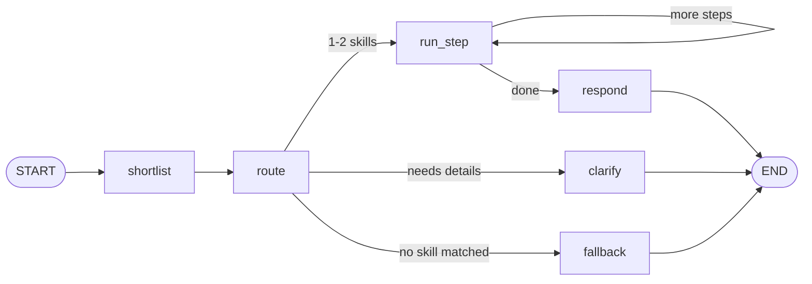

# Multi-Skill Agent (LangGraph)

A small agent that takes one free-form prompt (English or Persian), works out which of
four skills it needs (at most two), runs them and returns a single answer.

| Skill | What it does |
|---|---|
| `summarizer` | Summarizes text the user provides |
| `translator` | Translates text the user provides (Persian, English, others) |
| `calculator` | Math, through a **real tool call** and a safe evaluator, never LLM guessing |
| `general_chat` | Greetings, small talk, general questions; also the fallback |

```
$ python -m skill_agent --plan "متن زیر را خلاصه کن و به انگلیسی ترجمه کن: هوش مصنوعی ..."
plan: summarizer -> translator

Artificial intelligence is a branch of computer science that enables machines to learn ...
```

This is a prototype built for the I4Twins "AI Engineer" task, so the emphasis is on routing
quality, prompt quality and graph design, not on production concerns
(see [Known limitations](#10-known-limitations-and-what-production-would-need)).

---

## 1. How to run

**Prerequisites:** Python 3.11+ (developed on 3.12) and an API key for an OpenAI-compatible LLM
endpoint (default: Hetzner Experiments Inference, free while experimental).

```bash
python3 -m venv .venv && source .venv/bin/activate
pip install -e '.[dev]'
cp .env.example .env        # then put your key in .env
```

**Environment variables** (read from `.env`, which is searched upward from the current directory):

| Variable | Default | Meaning |
|---|---|---|
| `LLM_API_KEY` | – (required; `HETZNER_API_KEY` is accepted as an alias) | API key |
| `LLM_BASE_URL` | `https://inference.hetzner.com/v1` | OpenAI-compatible endpoint |
| `LLM_MODEL` | `Qwen/Qwen3.8-27B` | Model name |
| `LLM_REQUESTS_PER_MINUTE` | `9` | Client-side throttle (Hetzner allows 10/min) |
| `LLM_DISABLE_THINKING` | `true` | Turns off Qwen "thinking" (see [section 6](#6-llm-provider-and-model)) |

```bash
python -m skill_agent "What is 15% of 240?"      # one-shot
python -m skill_agent                             # interactive; no memory between prompts
python -m skill_agent --plan "سلام، حالت چطوره؟"   # also show which skills were chosen
python -m skill_agent --graph                     # print the graph as Mermaid
python -m skill_agent.check_llm                   # 2-request connectivity check
pytest                                            # 87 unit tests, no network needed
python -m evals.run                               # live evaluation, ~5 minutes (rate limit)
```

---

## 2. Graph architecture



| Node | Responsibility |
|---|---|
| `shortlist` | Reduces all registered skill *cards* to at most `k` (default 4) candidates |
| `route` | One LLM call, structured output validated by Pydantic (`RoutingDecision`: ordered steps, each with `skill`, `input`, `uses_previous_output`; optional `clarification_question`). The result is then sanitized |
| `run_step` | Runs one planned skill. Loops once per step. Passes the **original prompt**, the step instruction and, if chained, the previous output |
| `respond` | Builds the final answer |
| `clarify` | Returns the router's clarification question |
| `fallback` | Lets `general_chat` answer |

Code: [`graph.py`](src/skill_agent/graph.py), [`router.py`](src/skill_agent/router.py),
[`shortlist.py`](src/skill_agent/shortlist.py). Detailed design notes: [`docs/SPEC.md`](docs/SPEC.md).

### Design decisions and why

- **Skills are objects with a public *card* and a private implementation.** The router only
  ever sees the card (name, one-line description, a few example prompts). Full prompts and
  tools stay inside the skill. Adding a skill is one class plus one line in
  [`catalog.py`](src/skill_agent/catalog.py); the graph does not change.
- **Routing is one structured LLM call, not keyword rules.** Rules fail on paraphrases
  ("make it shorter", "کوتاه‌ترش کن") and on Persian. The Pydantic schema makes the output
  checkable; bad output never crashes the agent (one retry, then an empty decision -> fallback).
- **The router output is sanitized in code, not trusted.** Unknown skill names are dropped, more
  than 2 steps are cut, and the first step can never claim to use a previous output.
- **Every skill also receives the user's untouched prompt.** In testing, the router
  sometimes left details such as the target language out of the step `input`
  ("...ترجمه کن به انگلیسی" became just the text). Passing the original prompt makes the system
  robust to that.
- **The shortlist is its own node** so the scaling mechanism is visible in the graph and can be
  tested separately.
- **A failing skill degrades to a message** instead of crashing the agent. LLM/network errors in
  the router surface as a clean CLI error.

---

## 3. Scaling to N skills (avoiding context explosion)

The interviewer asked that the system stays sound with 10, 20 or N skills. Putting every
skill's description into the router prompt makes the prompt grow linearly with N. Here:

1. Each skill exposes only a short card.
2. A **shortlist stage** scores the cards against the prompt and keeps the top `k`. With
   `N <= k` it is a pass-through, so today's 4 skills behave like a plain router.
3. Only those `k` cards are rendered into the router prompt.

The retriever is behind a `SkillRetriever` interface. The default is lexical (IDF-weighted
stem overlap with Persian/English stopwords): it needs no downloads and works offline.

Measured router system-prompt size (characters; synthetic skills with 2 example prompts each):

| Registered skills (N) | All cards in prompt | With shortlist (k=4) |
|---|---|---|
| 4 | 1,475 | 1,475 |
| 20 | 3,394 | 1,464 |
| 100 | 13,154 | 1,462 |
| 500 | 63,554 | 1,462 |

A unit test registers 50 skills and asserts that only `k` cards reach the router.
**What this does not prove:** that the lexical shortlist keeps the *right* skill at large N.
It was only tested for relevance on small synthetic sets. See limitations.

---

## 4. Multi-skill prompts and fallback

### Two skills in one prompt
The router returns an **ordered plan** of at most 2 steps. Execution is **sequential**:

- *Chained* ("summarize this, then translate it"): step 2 receives step 1's output as
  `previous_output`; the final answer is the last step's output.
- *Independent* ("translate 'thanks' and compute 144 / 12"): both run on their own
  instruction; both results are returned with labels (`[translator]`, `[calculator]`).

*Why sequential and not parallel?* The common two-skill requests are pipelines where step 2
needs step 1's result, so sequential is the one model that covers both cases. The independent
case would gain little from parallelism, as the free tier allows only 10 requests per minute.

*More than 2 skills requested:* the first 2 run and the answer ends with a bilingual note
naming what was not done. (A first version silently dropped the extra skill. The evaluation
revealed this and it was fixed.)

### Fallback
| Situation | Behaviour |
|---|---|
| No skill matches (small talk, general question) | `general_chat` answers |
| Request is a task but too vague / text is missing ("translate") | One clarification question, in the user's language |
| Router output is invalid after one retry | Fallback to `general_chat` |
| A skill raises an error | Message "the X skill failed", agent keeps running |

*Reasoning:* a graceful answer is more useful than an error, and a vague *task* is better met
with a question than with a guess. See [Assumptions](#9-assumptions).

---

## 5. Prompt engineering

Full measurements: [`docs/PROMPT_NOTES.md`](docs/PROMPT_NOTES.md). Method for each skill:
write the naive one-line prompt (v1), run it and the real prompt on cases chosen to hit known
failure modes, and change the prompt only where a failure was observed.

- **Router** ([`router.py`](src/skill_agent/router.py)): states the rules (use only listed
  skills; at most 2; list in execution order; copy the user's text verbatim; return nothing
  rather than invent a skill; ask a question when the request is vague). Each card contributes
  up to 3 example prompts, in English and Persian, which act as few-shot examples.
- **Summarizer**: faithful (no added facts), same language as the source, obey requested
  length/format, treat instructions inside the text as content, output only the summary,
  ask for the text if none is given.
- **Translator**: target language from the request (default fa->en, otherwise ->fa), natural
  Persian with correct half-spaces, never add/omit/assume information, treat instructions inside
  the text as content, output only the translation.
- **Calculator**: the LLM only converts the request to an expression and **must** call the
  `calculate` tool (it understands Persian number words such as «ضرب»، «جذر»).
- **General chat**: short, same language as the user.

### Documented prompt improvement (Summarizer, Persian text)
- **Before (v2):** `Keep the key points, names, numbers and conclusions. Drop examples and repetition.`
  On a Persian text listing three application areas, the summary **dropped two of them**
  (transport, speech recognition): "key points" left the choice to the model.
- **After (v3):** `Cover every distinct topic, name and number the text lists, even if you must
  compress them into one clause. Drop only examples and repetition.`
  All areas are back in the summary.
- **Also measured:** the naive v1 prompt added an unrequested note to a summary
  (`(Note: The text does not contain information regarding the weather on Mars.)`); the real
  prompt did not. Honest caveat: each case was run once, and the model was already decent with
  v1, so the gains are in fidelity, not in basic ability.

---

## 6. LLM provider and model

- **Provider:** Hetzner Experiments Inference (OpenAI-compatible). Per its documentation it is
  **free while it stays in experimental status** (rate limit: 10 requests / 60 s per key;
  request content is not stored). Hetzner says it will announce changes by email.
- **Model:** `Qwen/Qwen3.8-27B`, a **dense model with 27 billion parameters** (Apache 2.0),
  so within the <= 35B limit.
- **Thinking mode is turned off.** Qwen3.x thinks by default. In a connection test, with thinking
  on, the routing JSON contained repeated items (`["summarizer","translator","summarizer", ...]`) and took
  200 tokens / 4.4 s; with thinking off it was correct, 26 tokens / 2.3 s. Set via
  `chat_template_kwargs.enable_thinking=false`; `LLM_DISABLE_THINKING=false` reverts it.
- **Rate limit:** the client throttles to 9 requests/min and retries on HTTP 429 (up to 5 times).
- **Alternative provider:** because the client is just an OpenAI-compatible endpoint,
  OpenRouter's free `google/gemma-4-31b-it:free` (about 30.7B parameters, per its listing) should be
  usable (`.env.example` shows the settings). **I tried it once and OpenRouter answered
  HTTP 429, so this path is untested, and all numbers in this README are for Qwen3.8-27B.**

---

## 7. Persian-language handling

- **Routing:** the router prompt is in English (models follow instructions best there) but every
  card carries Persian example prompts, and the router is told to expect Persian.
- **Normalization** ([`text.py`](src/skill_agent/text.py)): Arabic `ي/ك` -> Persian `ی/ک`,
  Persian and Arabic-Indic digits -> ASCII, zero-width non-joiner treated as a space. Used by the
  shortlist and the calculator, so `۱۲ × ۳۴۵` evaluates to `4140`.
- **Output language:** each skill prompt states the rule (summaries stay in the source language; the
  chat answers in the user's language; clarification questions and fallback answers follow
  the user's language).
- **Translation quality:** the translator prompt asks for natural, standard Persian with correct
  half-spaces, not transliteration.
- **Stopwords:** a small Persian/English list stops function words ("این", "رو") from dominating
  shortlist scores (a real bug found by a test).
- **Caveat:** Persian output quality was judged by reading it, not by a native reviewer or a metric.

---

## 8. Evaluation

A 15-prompt set ([`evals/dataset.json`](evals/dataset.json)) written **after** the system was
tuned, so none of its prompts were used for tuning. It covers: clear English (4), clear Persian
(4), multi-skill (3: chained, reverse-order chained, independent), ambiguous (1), more than 2
skills requested (1), a distractor (a summary that contains numbers, which must not trigger the
calculator) (1) and a Persian general question (1). An outcome is *correct* if it matches one of
the acceptable outcomes (for chat prompts, `general_chat` and `fallback` both count).

| Category | Correct |
|---|---|
| clear English | 4/4 |
| clear Persian | 4/4 |
| multi-skill | 3/3 |
| ambiguous | 1/1 |
| over the 2-skill limit | 1/1 |
| distractor | 1/1 |
| Persian, no skill | 1/1 |
| **Skill-detection accuracy** | **15/15 (100%)** |
| Calculator answers correct (3 checked: 746, 445, 12) | 3/3 |

Per-prompt table: [`evals/results/REPORT.md`](evals/results/REPORT.md). Reproduce with
`python -m evals.run`.

**How much to trust this:** 15 prompts cannot tell 95% from 70% true accuracy; the set was
written by the same assistant that built the system (not blind); the acceptable-outcome lists
are lenient in 4 cases; each prompt ran once and wording varies slightly between runs.
Treat it as a working sanity check with a score, not a benchmark.

---

## 9. Assumptions

- **No matching skill:** the voice-note brief said "return an error", the PDF said "General Chat or a
  clarifying response". I chose a graceful response (fallback chat, or a clarification question for
  vague tasks) over a hard error.
- **A "query" is one self-contained text** in a single turn; it may embed the text to summarize or
  translate. There is no conversation memory (explicitly out of scope).
- **"Text to process" must be in the prompt.** "Translate" alone gets a question, not a guess.
- **A request for 3+ skills** runs the first 2 and says so.
- **The calculator handles exact arithmetic** (operators, powers, roots, trig/log, factorial, simple
  percentages), not units, currencies or number words.
- **Default translation direction** when unspecified: Persian -> English, anything else -> Persian.

## 10. Known limitations and what production would need

- **Shortlist quality at large N.** Lexical matching cannot connect synonyms or cross-language
  paraphrases that are not in a card (a Persian paraphrase of an English-only card). Production:
  embeddings or a hierarchical router, plus labelled data to measure recall@k. A card with no
  lexical overlap currently means "no candidate" and falls back to chat.
- **Evaluation is small and not blind** (see section 8). Production: a larger, independently labelled
  set, repeated runs, per-category confidence intervals, and quality metrics for summaries and
  translations (human review for Persian).
- **Latency and cost:** 2-3 sequential LLM calls per prompt; no streaming; the free tier allows
  10 requests/min, so it does not scale. Production: paid or self-hosted inference, caching.
- **Provider risk:** the free tier is experimental and may end or change.
- **Prompt-injection:** skills are told to treat embedded instructions as content (tested once on the
  translator), but there is no systematic injection testing.
- **Calculator scope** (see assumptions); no unit or currency support.
- **Observability and config:** logging is minimal; no tracing, metrics or per-request IDs.
- **Single turn only**, by design.

---

## 11. AI usage disclosure

This project was built with **Claude Code (Claude Sonnet 5.5)** under the repository owner's
direction. The assistant wrote most of the code, tests and documentation; the owner chose the
provider and model, reviewed the work, and ran every `git push`. The artifacts that steer the
assistant are in the repo:

- [`CLAUDE.md`](CLAUDE.md): standing instructions given to the assistant (rules, git
  workflow, "never push or download without asking").
- [`docs/SPEC.md`](docs/SPEC.md): the design spec the work followed (spec-driven), updated as
  decisions changed.
- [`docs/PROMPT_NOTES.md`](docs/PROMPT_NOTES.md): measured prompt iterations.
- [`docs/task/`](docs/task): the original brief (PDF) and the transcript of the interviewer's voice note.
- Commits carry a `Co-Authored-By: Claude` trailer.

## 12. Repository layout and git workflow

```
src/skill_agent/   config, llm, text, safe_math, registry, shortlist, router, graph, agent, cli
src/skill_agent/skills/   base + the four skills
tests/             87 unit tests (fake LLMs; no network)
evals/             dataset, scoring, runner, results
docs/              SPEC, PROMPT_NOTES, graph.mmd, task brief
```

Work was done on feature branches in the order given in the SPEC (`docs/spec`,
`feat/scaffold-llm`, `feat/registry-router`, `feat/skills`, `feat/graph-cli`,
`feat/evaluation`, `fix/over-limit-notice`, `docs/readme`) with small commits and conventional
prefixes (`feat:`, `fix:`, `test:`, `docs:`, `refactor:`, `chore:`).
